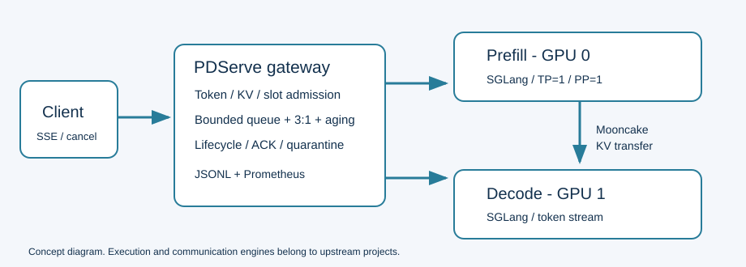

# PDServe：面向混合长短请求的 Prefill/Decode 分离服务

PDServe 探索一个具体问题：长输入与短输入共享推理服务时，如何对 KV 资源和请求队列做有界管理，并在取消、超时或节点退出后确认资源确实释放。

你可以在没有 GPU 的 Windows/Linux 上运行调度模拟与 CPU 测试；在 Linux 双 GPU 环境中使用 SGLang 和 Mooncake 部署真实 P/D 服务，提交单文本 completion 请求并接收 SSE；也可以只复算本仓库公开的历史聚合结果。项目面向学习、研究和求职展示，尚未完成生产级验证。

**主要交付**：可独立运行的网关源码、固定上游引擎补丁、无 GPU 测试、合成示例、脱敏结果摘要和来源清单。[中文项目 PDF](docs/PDServe_项目报告.pdf)涵盖设计、历史实验、真实迭代与限制。

## 快速体验：无需 GPU、无需下载模型

执行位置：本地 Windows PowerShell，进入本候选目录。

```powershell
Set-Location -LiteralPath "C:\src\PDServe"
python tools/check.py
python examples/mock_scheduler.py
python tools/summarize_results.py
```

执行位置：Linux 终端，进入你解压得到的独立候选目录。

```bash
cd /path/to/PDServe-public-candidate-20261025
python3 tools/check.py
python3 examples/mock_scheduler.py
python3 tools/summarize_results.py
```

CPU 检查使用标准库，不安装系统依赖，不连接推理服务。`mock_scheduler.py` 只是合成队列示例，不代表真实 GPU、KV 传输或模型输出。Python 3.10 语法检查不等于本轮已经在 Python 3.10 执行过所有测试；执行环境见[检查记录](docs/CHECKS.md)。

## 主要功能与源码入口

| 功能 | 实际实现 | 关键位置 |
|---|---|---|
| 容量准入 | tokenizer 精确计数；P 预留输入，D 预留输入+最大输出；page 取整；90% KV 与 slot 限额 | `src/pdserve/core.py` |
| 有界排队 | 队列 128，排队超时 30s；同类 FIFO | `WaitQueue`、`Service.dispatch` |
| 公平调度 | 输入 ≤2048 为短请求；短:长 3:1；长请求等待 ≥5s 获得下一次可容纳派发机会 | `WaitQueue.choose` |
| 上下文边界 | 固定引擎要求 input+max_output **严格小于** 16384 | `src/pdserve/context_guard.py` |
| P/D 请求编排 | 固定内部 ID 与 bootstrap room，调用 SGLang `/generate`；Mooncake 负责传输 | `backend.py`、`service.py` |
| 生命周期 | 分开记录终态和清理；匹配 epoch/ID/room 的真实 cleanup ACK 才释放预算 | `Ledger.release_ack`、`Service.poll` |
| 故障隔离 | 取消传播、断连、超时、节点异常；隔离后拒绝新请求；旧租约明确退役 | `service.py`、引擎补丁 |
| 观测 | JSONL、Prometheus、客户端 SSE TTFT/ITL、阶段窗口 | `telemetry.py`、`benchmarks/analyze.py` |

源码没有实现通信引擎、TP/PP 或 AgentCache。SGLang 执行模型，Mooncake 执行 KV 传输；每个引擎 `TP=1、PP=1`。

## 架构与流程



1. 请求进入网关，检查 API 形状并精确编码输入。
2. 队列按 FIFO 或 3:1+aging 选择能同时满足 P/D 预算的请求；单事件循环内原子预留。
3. P 计算 Prefill，通过 Mooncake 把 KV 交给 D；D 输出 token，网关转换为 completion SSE。
4. 终态返回与资源清理是两个事件。确认 allocator、metadata、compute、transport 清理后释放相应预算。
5. 清理未确认时保持租约并隔离；恢复需要新 epoch 和操作者确认旧进程已退出，不重试已经输出的请求。

详见[架构说明](docs/ARCHITECTURE.md)、[复现说明](docs/REPRODUCE.md)和[故障演示](docs/DEMO.md)。

## 真实 GPU 运行（Linux，用户手动执行）

先按复现文档在**新建环境和新建输出目录**安装固定依赖、校验本地模型、重建引擎补丁。本轮未安装 GPU 依赖、下载模型或运行 GPU，以下便携入口只是 CPU/干运行检查通过。

```bash
# 在候选目录。先完成 REPRODUCE.md，两个后端终端使用同样的 PYTHONPATH。
export PDSERVE_MODEL_PATH=/absolute/path/to/Qwen2.5-7B-Instruct
export PYTHONPATH="$PWD/src:$PWD/work/patched-site:$PWD/benchmarks"

# 终端一
python scripts/serve_backend.py prefill --model-path "$PDSERVE_MODEL_PATH"
# 终端二
python scripts/serve_backend.py decode --model-path "$PDSERVE_MODEL_PATH"
# 终端三（后端就绪后）
python -m pdserve.launch fair --model-path "$PDSERVE_MODEL_PATH"
# 终端四（不会自动启动服务）
python examples/sse_client.py --request-id demo-001
```

P/D 服务地址为本机 `30000/30001`，网关 `8000`，bootstrap `8998`。端口和本机回环地址不是原始机器的内部地址。默认 IB 设备名 `mlx5_0` 可以通过 `--ib-device` 显式指定。停止服务使用各启动终端 `Ctrl+C`；公开版不包含自动杀进程工具。

API 提供 `/v1/completions`、`/health/live`、`/health/ready`、`/metrics`、`/requests/{id}`、`POST /requests/{id}/cancel`、`/admin/state`、`POST /admin/recover`。只支持单个文本 prompt、`n=1`；不支持批量 prompt、聊天/工具协议或自动重试。管理接口未鉴权，仅用于隔离的本机实验环境。

## 实验设置与结果

历史模型：**Qwen2.5-7B-Instruct，BF16，context=16384**。同一对 A100-SXM4-80GB、相同模型文件、固定随机种子和合成 token 轨迹；关闭前缀缓存。输入 512/8192 token，输出 128/512 token。短请求占比 20%/80%；开放环到达率 0.25/2.0 req/s；每项 40 请求，重复 3 次。合计 36 次正式成功运行、1440 个请求，另有 1 次失败尝试，保留在私有证据中。

三种配置：双混合副本 FIFO、P/D FIFO、P/D 3:1+aging。P/D 网关活动上限参数 32，但实际 slot 受 90% 的 33 个引擎 slot 限制，观测有效上限 **29**。双副本每卡最多 32 个活动请求，总计 64；这是相同两张 GPU 的不同架构资源使用方式，不是相同总并发的调度消融。

| 场景（短请求占比/到达率） | 双混合副本 req/s / TTFT p95 ms | P/D FIFO | P/D fair |
|---|---:|---:|---:|
| 20% / 0.25 | 0.2551 / 626.01 | 0.2545 / 947.25 | 0.2536 / 7287.51 |
| 20% / 2.0 | 1.2601 / 641.93 | 1.2125 / 2258.34 | 0.8124 / 32183.35 |
| 80% / 0.25 | 0.1778 / 621.59 | 0.1773 / 2018.76 | 0.1776 / 670.76 |
| 80% / 2.0 | 2.0441 / 593.23 | 1.8362 / 2297.31 | 1.9695 / 752.86 |

所有数值是该配置已完成运行的观测值，不代表最大服务容量。2.0 req/s 在历史目录中被命名为 saturated，但这只是负载标签；没有容量搜索，不能保证所有配置均达到稳态饱和。TTFT 来自客户端首个正 token-count SSE 到达；ITL 只统计 +1 token 事件间隔，报告覆盖率，不能把合并帧平均成虚构的逐 token 时间。

**本轮审核修正**：36 次性能运行均无网关派发重排，最大网关排队小于 1ms；因此性能差异不能归因于公平调度算法。3:1、aging 与背压的真实功能证据来自专门设置活动上限 2、队列上限 4 的 Stage2f 验收。此前“67% TTFT 改善/7.3% 吞吐提高”只可描述为两个 P/D 会话的观测差异，不能写成算法提升。

P/D 在本组试验没有超过双混合副本。长请求占 80% 时存在明显退化和很大的 repeat 波动；阶段窗口与瓶颈相符，但不能仅凭它们判定 Mooncake 网络本身是根因。跨配置观测策略也不同：P/D 0.25s 获取阶段状态；混合副本启动后每 1s 读取 metrics，存在监测开销混杂。详见[完整结果与负结果](docs/RESULTS.md)。

## 真实迭代与贡献边界

[迭代历史](docs/ITERATION_HISTORY.md)分别记录模型、输入、工具执行层、核心调度、评测和发布工具。模型没有微调、没有适配器变化。最终接受的是固定 SGLang 上游加 Stage2c1 最终补丁、Stage2d1 网关、严格上下文 guard 与 Stage3d 测量策略；本候选只是布局、便携入口、文档和审查修订，不是算法升级。

| 阶段 | 解决的问题 | 验证 | 最终采用 |
|---|---|---|---|
| Stage1 | 固定环境、单引擎和真实 P/D 链路 | 历史双卡验收 | 是 |
| Stage2a/b/b2/c1 | 阶段观测、清理 ACK、取消与超时隔离 | CPU fixtures + 历史真卡证据 | 最终补丁 |
| Stage2d/e/f | 资源准入、严格边界、节点退出与调度行为 | CPU + 专项双卡验收 | 是 |
| Stage3a/b/c/d | 客户端测量、两类基线、同卡配置对照 | 36 次 raw 复算 | 是，带证据限制 |
| 公开候选 2026-10-25 | 便携目录、隐私/许可、中文 PDF 和 CI | 本轮 CPU/重建/文档检查 | 候选，未重做 GPU 验收 |

## 目录、资源与许可

```text
src/pdserve/       保持原始核心字节的服务模块 + 显式便携入口
patches/          固定上游合并补丁和 before/after 哈希
engine_modules/   三个项目新增引擎模块，原字节保留
benchmarks/       测量、trace、聚合与新 campaign 工具
scripts/          显式用户运行的后端启动与预检查
examples/         合成队列示例、真实服务客户端、固定 trace
tests/            无 GPU 的 CPU 测试
resources/        模型本地文件哈希，权重不入库
results/          脱敏聚合摘要，绝非原始响应
provenance/       来源映射、摘要规则与候选版本清单
docs/             复现、迭代、限制、检查和中文 PDF
```

模型和上游外链见 [THIRD_PARTY.md](THIRD_PARTY.md)。已记录本地权重/分词器 SHA256，但没有经过确认的上游 model revision，不保证重新下载得到相同字节。完整历史 Linux freeze 已保留，当前 wheel/镜像可用性未重新验证。训练效果、模型质量和真实业务效果均未评估。

本候选代码采用 Apache-2.0；上游 SGLang 的许可证与版权归属单独保留。Mooncake/FlashInfer/PyTorch/Qwen 权重不随仓库打包。人工与 AI 辅助开发的工作归属说明见 [CONTRIBUTIONS.md](CONTRIBUTIONS.md)。公开文件范围见 [PUBLIC_SCOPE.md](docs/PUBLIC_SCOPE.md)，未解决项见 [LIMITATIONS.md](docs/LIMITATIONS.md)。

## 检查与发布

本轮未自动 SSH、commit、push、创建 GitHub 仓库，也未运行模型。候选目录没有 `.git`。CI 只运行 CPU/公开清单检查，不执行 GPU 测试。

- [本轮检查记录](docs/CHECKS.md)
- [求职展示表述](docs/RESUME.md)
- [Windows 手动上传 GitHub](docs/UPLOAD.md)
- [贡献说明](CONTRIBUTING.md)
